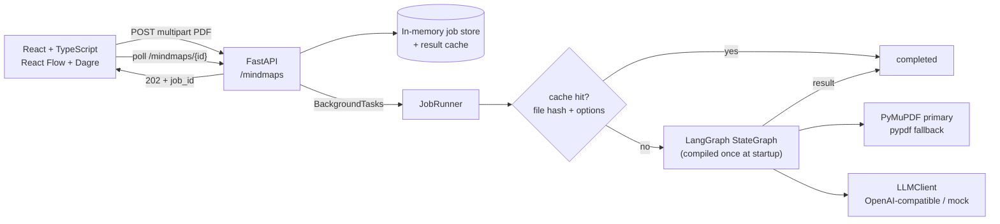
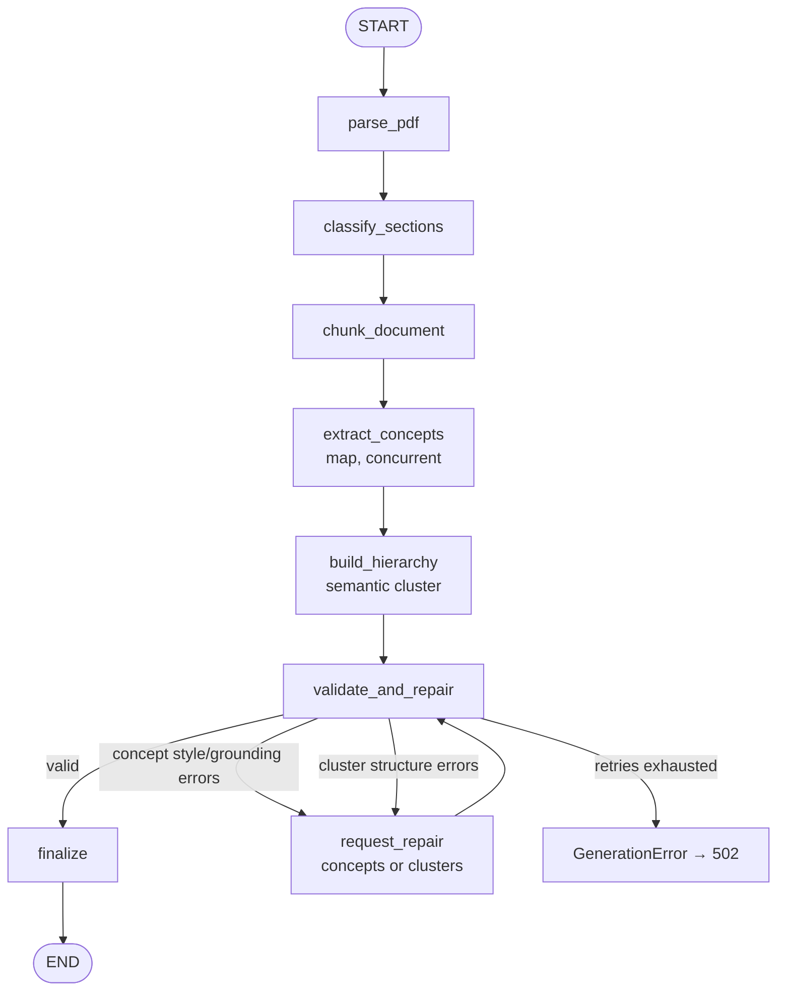

# Mind Map Generator

Turn a text-based PDF into an **interactive, concept-first mind map** — a NotebookLM-style
knowledge map where category nodes are clean generalizations and every leaf carries a visible,
grounded explanation with source-page citations.

The UI is inspired by **WONK’s** dark-ink / cream / violet visual language (Onest + Manrope),
with a focused upload flow that exposes only the output-language choice.

> **Grounding rule:** every leaf explanation must come from the uploaded PDF, cite real pages,
> and pass style + grounding validation. Learning objectives and activities are never turned
> into map nodes.

---

## What changed in the concept-first version

- **No click-to-reveal content.** There is no node side panel and no summary hidden in the data.
  The map itself carries the content, so PNG/SVG/Markdown exports keep the explanations.
- **Branch vs leaf schema.** `root`/`branch` nodes contain only a label and children. `leaf`
  nodes contain the term, a declarative explanation, and `source_pages`.
- **Concept cards, not section summaries.** Content sections are converted into grounded
  term → explanation cards with evidence quotes. Glossary definitions are used as evidence.
- **Semantic clustering.** A second LLM call groups concept IDs into 4–8 categories (and
  optional subgroups) instead of copying document headings.
- **Scaffold filtering.** “Learning Objectives”, “Activities”, “Knowledge Check”,
  “Suggested Answers”, “Final Takeaway”, metadata and how-to-use sections are excluded.
  Objectives are passed to the prompts only as a coverage checklist.
- **Quality gates.** Imperative/task language (“Explain…”, “Describe…”), low source overlap,
  empty categories, duplicate IDs, missing concepts, over-wide groups and scaffold labels trigger
  targeted repair or a clear `502`.
- **Deterministic structural repair.** Before asking the LLM to retry, the cluster plan is
  normalized: unknown/duplicate IDs are dropped, unplaced concepts are assigned by content
  overlap, wide subgroups are split, tiny categories are merged, and scaffold labels are renamed.
  The LLM repair path is reserved for concept style/grounding problems that cannot be fixed
  deterministically. This prevents a good concept inventory from failing because of grouping
  bookkeeping alone.
- **Readable initial view + high-resolution export.** The canvas opens focused on the root at a
  readable zoom; PNG/SVG export renders the complete graph at high resolution.

---

## Architecture



### LangGraph pipeline



| Stage | Input → output |
| --- | --- |
| `parse_pdf` | PDF bytes → cleaned pages, sections and page ranges |
| `classify_sections` | sections → `content / objectives / activities / reference / scaffold` + objectives checklist |
| `chunk_document` | content/reference sections → page-aware chunks with overlap |
| `extract_concepts` | chunks → grounded concept cards (`term`, `explanation`, `evidence`, pages) |
| `build_hierarchy` | concept inventory → categories/subgroups assigning every concept ID |
| `validate_and_repair` | concepts + cluster → repaired tree, or targeted repair prompts |
| `finalize` | tree → stable path IDs, counts, metadata, cache entry |

---

## Frontend

- React 18 + TypeScript + Vite, **React Flow** (`@xyflow/react`) + **Dagre**.
- WONK-inspired design system: `#0a0a12` ink, `#f7f7fb` cream, `#7c5cff` violet,
  **Onest** for display and **Manrope** for body text.
- Dark rounded header, dark hero, cream workspace, violet primary actions, rounded cards.
- Expand/collapse branch chevrons, pan/zoom, fit view, horizontal/vertical toggle.
- Leaves are white cards with the term, explanation and page reference visible on the map.
- No node click handlers, selection, side panel or hover summaries.
- Upload screen exposes **only the output-language dropdown**; depth/branch controls are gone.
- Exports: JSON, Markdown outline, full-graph PNG and SVG.
- Bundled curated sample map (`src/data/sample-mindmap.json`) renders without a backend.

---

## Project structure

```
.
├── backend/
│   ├── pyproject.toml            # uv-managed project
│   ├── .env.example
│   ├── src/mindmap_generator/
│   │   ├── api/                  # app factory/lifespan, routes, schemas, deps
│   │   ├── pdf/                  # extraction, cleaning, headings, classify.py
│   │   ├── graph/                # state, nodes, builder, concepts, validate
│   │   ├── llm/                  # base, openai_compat, mock, factory
│   │   ├── prompts/              # concept extraction / clustering / repair prompts
│   │   ├── jobs/                 # store, cache, runner, exports
│   │   ├── chunking.py
│   │   ├── config.py
│   │   ├── models.py             # schema v2 + LLM output schemas
│   │   ├── languages.py
│   │   └── logging_config.py
│   └── tests/                    # pytest + httpx TestClient, LLM always mocked
├── frontend/
│   ├── package.json
│   ├── src/
│   │   ├── components/           # upload, progress, canvas, nodes, icons
│   │   ├── lib/                  # api, tree, Dagre layout, exports
│   │   ├── data/                 # curated sample map
│   │   └── types/                # TypeScript mirror of schema v2
│   └── ...
├── README.md
└── .gitignore
```

---

## Mind map schema (version 2)

```json
{
  "document": {
    "filename": "lesson.pdf",
    "pages": 7,
    "language": "en",
    "title": "Large Language Models (LLMs)"
  },
  "mindmap": {
    "id": "root",
    "kind": "root",
    "label": "Large Language Models (LLMs)",
    "source_pages": [],
    "children": [
      {
        "id": "root.2",
        "kind": "branch",
        "label": "Core Concepts",
        "source_pages": [],
        "children": [
          {
            "id": "root.2.1",
            "kind": "leaf",
            "label": "Tokens",
            "explanation": "Tokens are units of text processing—words, parts of words, or symbols—that the model reads and predicts.",
            "source_pages": [2],
            "children": []
          }
        ]
      }
    ]
  },
  "meta": {
    "schema_version": 2,
    "model": "gpt-4o-mini",
    "generated_at": "2025-01-15T10:30:00Z",
    "node_count": 50,
    "leaf_count": 39,
    "branch_count": 10,
    "depth": 3,
    "cache_hit": false,
    "repair_attempts": 0,
    "generation_path": "concept_clustering",
    "output_language": "en",
    "processing_ms": 8421,
    "fixes": [],
    "warnings": []
  }
}
```

Rules enforced by the prompts and validator:

- `root`/`branch`: label + children only; **no explanation**.
- `leaf`: non-empty explanation, source pages, **no children**.
- Leaf explanations: declarative, roughly 5–32 words, grounded, no task/learning-objective
  language, no meta commentary.
- Category labels: 1–4 words, conceptual, no scaffold headings.
- 3–8 categories (the prompt asks for 4–8; 3 is accepted for smaller inventories), every
  concept ID assigned exactly once, 1–6 leaves per subgroup, maximum depth of 3 below the root.
- Evidence quotes are normalized and checked against the cited pages; content-word overlap with
  the page text is a second grounding check.

---

## Setup and run

> **Run the backend and frontend in two separate terminals.** The backend command must be run
> from `backend/`; the Python package is installed into `backend/.venv` by `uv sync`. Running
> `uv run uvicorn ...` from `frontend/` gives `ModuleNotFoundError: No module named
> 'mindmap_generator'`.

**Terminal 1 — backend:**

```bash
cd backend
cp .env.example .env
# Either set API_KEY=... (OpenAI-compatible provider)
# or set LLM_PROVIDER=mock for an offline heuristic demo.
uv sync
uv run uvicorn mindmap_generator.api.main:app --reload --port 8000
```

- API docs: <http://127.0.0.1:8000/docs>
- Health: <http://127.0.0.1:8000/health>

> The backend loads `.env` from its **current working directory**, so start it from
> `backend/`. After editing `.env`, restart uvicorn.

If port 8000 is already taken:

```bash
uv run uvicorn mindmap_generator.api.main:app --reload --port 8010
# in frontend/:
VITE_BACKEND_URL=http://127.0.0.1:8010 npm run dev
```

**Terminal 2 — frontend:**

```bash
cd frontend
npm install
npm run dev        # http://localhost:5173, proxies /mindmaps and /health to :8000
```

Production build:

```bash
npm run build      # tsc --noEmit && vite build → frontend/dist
```

> **Sandboxed/restricted hosts:** if `uv` cannot write `~/.cache/uv`, set
> `export UV_CACHE_DIR="$PWD/.uv-cache"` before the `uv` commands. If npm cannot write
> `~/.npm`, install with `npm install --cache "$PWD/.npm-cache"`. Both cache folders are
> gitignored.

### Tests

```bash
(cd backend && uv run pytest)        # 65 tests: PDF, classification, concepts, validation, language, LLM config, graph, API
(cd frontend && npm test)            # 16 tests: tree, layout, exports
(cd frontend && npm run build)       # type-check + production bundle
```

Tests never call an LLM and never need an API key: they inject a scripted `FakeLLMClient` or use
`LLM_PROVIDER=mock`. PDF fixtures are generated programmatically with PyMuPDF.

### Troubleshooting: “Every concept-extraction call failed”

This error usually means the backend has **no usable LLM configuration**, not that OpenAI is
down. It fails before any network request when `API_KEY` is empty.

Check it without exposing the key:

```bash
cd backend
uv run python -c "from mindmap_generator.config import Settings; s = Settings(); print('key present:', bool(s.llm_api_key), '| provider:', s.llm_provider, '| model:', s.llm_model)"
```

- `key present: False` → put `API_KEY=sk-...` in `backend/.env` (or export it in the terminal)
  and restart the backend. Do not commit `.env`.
- `key present: True` but the job still fails → check `GET /health` (`llm_configured`), then the
  provider dashboard for quota/billing, the model name, and whether the provider supports
  `response_format: json_schema` (use `LLM_JSON_MODE=json_object` if not).
- Run uvicorn from `backend/` so `.env` is found.
- No key available? `LLM_PROVIDER=mock uv run uvicorn mindmap_generator.api.main:app --reload --port 8000`
  runs the deterministic offline demo.

The failed job now returns the concrete cause:
`No LLM API key configured. Set API_KEY=... in backend/.env ...`.

### Offline demo

```bash
cd backend
LLM_PROVIDER=mock uv run uvicorn mindmap_generator.api.main:app --reload --port 8000
```

The `mock` provider is a deterministic heuristic extractor for demos/smoke tests, **not** a
language model. For real content quality, configure an LLM provider. The frontend also has an
**Explore a sample map** action that renders the curated 50-node lesson map without a backend.

---

## Environment variables

| Variable | Default | Purpose |
| --- | --- | --- |
| `LLM_PROVIDER` | `openai` | `openai` (any compatible endpoint) or `mock` |
| `LLM_MODEL` | `gpt-4o-mini` | Model name; never hardcoded outside config |
| `LLM_BASE_URL` | `https://api.openai.com/v1` | Compatible endpoint base URL |
| `API_KEY` (or `LLM_API_KEY`) | — | Provider secret; never committed |
| `LLM_JSON_MODE` | `json_schema` | Structured output; use `json_object` if unsupported |
| `LLM_CONCURRENCY` | `4` | Max concurrent concept-extraction calls |
| `LLM_MAX_OUTPUT_TOKENS` | `8192` | Output budget for clustering/repair |
| `MAX_UPLOAD_MB` | `25` | Upload limit |
| `MAX_PAGES` | `500` | Page limit |
| `CHUNK_CHARS` / `CHUNK_OVERLAP_CHARS` | `6000` / `300` | Concept-extraction chunking |
| `DEFAULT_MAX_DEPTH` / `MAX_DEPTH_LIMIT` | `3` / `3` | Levels below root |
| `DEFAULT_MAX_BRANCHES` / `MAX_BRANCHES_LIMIT` | `7` / `8` | Main category limits |
| `MAX_CHILDREN` | `6` | Max concept IDs per subgroup |
| `MAX_CONCEPTS` | `120` | Concept inventory cap |
| `MIN_LEAF_WORDS` / `MAX_LEAF_WORDS` | `5` / `32` | Leaf explanation length |
| `MIN_GROUNDING_OVERLAP` | `0.2` | Minimum content-word overlap with cited pages |
| `MAX_REPAIR_ATTEMPTS` | `2` | Concept/cluster repair attempts |
| `CACHE_ENABLED` | `true` | Cache by file hash + options |
| `JOB_TTL_MINUTES` | `60` | In-memory job expiry |
| `CORS_ORIGINS` | `["http://localhost:5173","http://127.0.0.1:5173"]` | JSON list |
| `LOG_LEVEL` | `INFO` | Structured JSON logs |

The API still accepts optional `max_depth` and `max_branches` form fields for scripted callers;
the frontend intentionally exposes only the language dropdown.

---

## API

| Method | Path | Purpose |
| --- | --- | --- |
| `GET` | `/health` | Liveness + effective provider/model + `llm_configured` |
| `POST` | `/mindmaps` | Upload PDF, create background job → `202 {job_id}` |
| `GET` | `/mindmaps/{job_id}` | Poll status/stage/progress/result/error |
| `GET` | `/mindmaps/{job_id}/export?format=json\|markdown` | Download export |
| `GET` | `/docs` | OpenAPI UI |

### Examples

```bash
curl -s http://127.0.0.1:8000/health

curl -s -X POST http://127.0.0.1:8000/mindmaps \
  -F "file=@lesson.pdf;type=application/pdf" \
  -F "language=en"
# → {"job_id":"…","status":"pending","status_url":"/mindmaps/…"}

curl -s http://127.0.0.1:8000/mindmaps/<job_id>

curl -OJ "http://127.0.0.1:8000/mindmaps/<job_id>/export?format=json"
curl -s "http://127.0.0.1:8000/mindmaps/<job_id>/export?format=markdown"
```

Status codes:

| Code | Meaning |
| --- | --- |
| `202` | Job accepted |
| `404` | Unknown/expired job |
| `409` | Export requested before completion |
| `413` | Upload exceeds size limit |
| `415` | Wrong extension or MIME type |
| `422` | Invalid/corrupt/encrypted PDF, page limit, no text, invalid params |
| `502` | LLM failure or generation could not pass validation |

Polling a failed job returns the original failure code with the job payload. Errors use
`{"error": {"code", "message", "status_code", "details"}}`.

---

## Swapping the LLM provider

The client speaks the OpenAI **chat completions** protocol with JSON-schema structured outputs:

```bash
# DeepSeek (use json_object if json_schema is unavailable)
LLM_BASE_URL=https://api.deepseek.com/v1
LLM_MODEL=deepseek-chat
LLM_JSON_MODE=json_object
API_KEY=...

# Local Ollama
LLM_BASE_URL=http://localhost:11434/v1
LLM_MODEL=llama3.1
API_KEY=ollama

# OpenRouter / Groq / vLLM / Together — same pattern
LLM_BASE_URL=https://openrouter.ai/api/v1
LLM_MODEL=anthropic/claude-3.5-sonnet
```

A stronger model generally improves concept extraction and category naming. For a
non-OpenAI-compatible provider, implement `LLMClient.generate_json()` in
`backend/src/mindmap_generator/llm/` and register it in `factory.py`.

---

## Design notes / assumptions

- **Heading priority:** PDF bookmarks → font size/bold heuristics → numbering patterns. Section
  classification then decides which sections are content/reference vs objectives/activities/
  metadata.
- **Objectives** are never nodes. They are extracted and passed to extraction/clustering as a
  coverage checklist.
- **Glossary** sections are treated as reference evidence; the glossary becomes definitions, not
  a branch.
- **Leaves** are the only nodes with explanations; every explanation has `source_pages` and a
  validated evidence quote where possible.
- **Categories** are generated from concept cards, not document headings. Scaffold labels are
  rejected by the validator.
- **Page refs** are 1-based and clamped; missing pages fall back to the parent/cited pages.
- **Language** is detected with a script/stop-word heuristic; the request’s `language` overrides
  the output language and is reported in `meta.output_language`.
- **Translated output:** terms, explanations and category labels are written in the requested
  output language, while evidence quotes stay verbatim in the source language. Lexical grounding
  overlap is skipped for translated output (translated words cannot match the source); the
  evidence quote and page citation remain the grounding anchors.
- **Language consistency:** for Cyrillic, CJK and Arabic targets the validator detects
  English/source-language leaks. Concept leaks trigger concept repair; category-label leaks
  trigger a focused label-translation call that preserves the cluster structure and concept IDs.
- **Exports:** JSON/Markdown from the canonical result; PNG/SVG are full-graph, high-resolution
  client-side renders (not just the viewport).
- **Cache:** SHA-256(file) + generation options, in-memory LRU.

---

## Limitations

- **Scanned PDFs are not supported** — no OCR; the API returns `no_extractable_text`.
- **In-memory job store/cache** — single-process only, lost on restart; use Redis/Postgres for
  production.
- **BackgroundTasks are not durable** — a process restart cancels in-flight jobs.
- **LLM quality matters** — extraction/clustering quality depends on the model; the validator
  can repair but cannot invent depth.
- **Mock mode is heuristic** — useful for offline demos, not a substitute for a real model.
- **Strict MIME check** — only `application/pdf` / `application/x-pdf`.
- **Page citations can be coarse** for sections spanning many pages.
- **Language detection is heuristic** for short or mixed-language documents.
- **Translation quality** depends on the model. `gpt-4o-mini` now translates successfully in
  testing, but a stronger model will produce more natural labels/explanations and fewer
  near-duplicate concepts.
- **Prompt injection** — document text is untrusted; prompts instruct the model to ignore
  embedded instructions, but this is not a perfect defense.
- **No auth, database, Docker, multi-user support, node editing, SSE, or RAG Q&A** in this MVP.
- **No upload persistence** — PDF bytes live in memory only while the job runs.

---

## Roadmap

- OCR for scanned PDFs.
- Click a leaf to ask a grounded follow-up question (RAG over page chunks).
- Merge multiple PDFs into one map.
- Edit labels/explanations in the UI and save versions.
- SSE/WebSocket progress instead of polling.
- Redis-backed jobs/cache and optional Postgres metadata.
- Authentication, quotas and audit logs.
- True radial layout and keyboard/accessibility improvements.
- Export a paginated PDF of the full map.

---

## Security

- No secrets are hardcoded; keys come from environment variables (`.env` is gitignored).
- Uploaded PDFs are parsed in memory and never written to disk by the API.
- Error payloads avoid echoing credentials; provider error bodies are truncated.
- CORS origins are explicit and configurable.
- The frontend never receives API keys.
