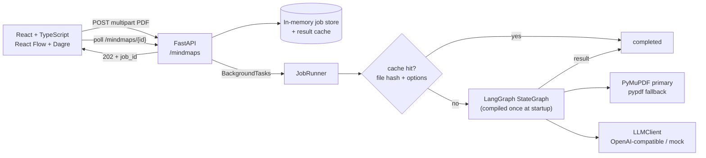
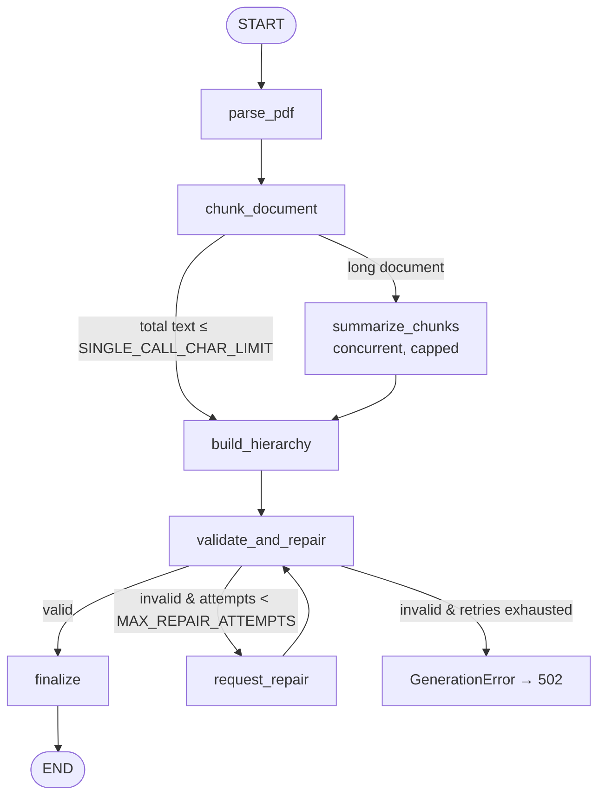

# Mind Map Generator

Upload a text-based PDF and get an **interactive, hierarchical mind map** of its content — a
NotebookLM-style explorer with pan/zoom, expand/collapse, source-page citations and
JSON/Markdown/PNG/SVG export.

The backend extracts the document structure (PDF outline → font/bold heuristics → numbering
patterns), summarizes chunks with a structured-output LLM, merges them into one grounded tree,
validates/repairs it, and exposes the result through an async job API. The frontend polls the
job, renders the tree with React Flow + Dagre, and lets you drill into every node.

> **Grounding rule:** every node must be supported by the uploaded PDF and carries
> `source_pages`. The prompts explicitly forbid outside knowledge.

---

## Architecture



### LangGraph pipeline



| Stage | Input → output |
| --- | --- |
| `parse_pdf` | PDF bytes → cleaned pages, detected headings, `sections[]` with page ranges |
| `chunk_document` | sections → page-aware chunks (char budget + overlap) |
| `summarize_chunks` | chunks → grounded summaries/concepts/terms (map, concurrent) |
| `build_hierarchy` | full text (short) or chunk summaries (long) → draft tree (reduce) |
| `validate_and_repair` | draft → repaired tree or validation errors for the repair loop |
| `request_repair` | draft + errors → corrected draft (max 2 attempts) |
| `finalize` | tree → stable IDs, counts, metadata, cache entry |

---

## Project structure

```
.
├── backend/
│   ├── pyproject.toml            # uv-managed project, no requirements.txt
│   ├── .env.example
│   ├── src/mindmap_generator/
│   │   ├── api/                  # main.py (app factory/lifespan), routes, schemas, deps
│   │   ├── pdf/                  # extract.py, headings.py, clean.py, types.py
│   │   ├── graph/                # state.py, nodes.py, builder.py, validate.py
│   │   ├── llm/                  # base.py, openai_compat.py, mock.py, factory.py
│   │   ├── prompts/              # templates.py (all LLM prompts live here)
│   │   ├── jobs/                 # store.py, cache.py, runner.py, exports.py
│   │   ├── chunking.py
│   │   ├── config.py             # pydantic-settings
│   │   ├── models.py             # Pydantic schema + LLM output schemas
│   │   ├── languages.py          # script/stop-word language detection
│   │   └── logging_config.py     # structured JSON logs with job_id
│   └── tests/                    # pytest + httpx TestClient, LLM always mocked
├── frontend/
│   ├── package.json
│   ├── src/
│   │   ├── components/           # upload, progress, canvas, node, side panel
│   │   ├── lib/                  # api client, tree utils, Dagre layout, exports
│   │   ├── data/                 # sample mind map JSON
│   │   └── types/                # TypeScript mirror of the API schema
│   └── ...
├── README.md
└── .gitignore
```

---

## Mind map schema

The backend (`models.py`) and frontend (`types/mindmap.ts`) share this shape. Do not change one
side without the other.

```json
{
  "document": {
    "filename": "paper.pdf",
    "pages": 12,
    "language": "en",
    "title": "Photosynthesis"
  },
  "mindmap": {
    "id": "root",
    "label": "Photosynthesis",
    "summary": "One or two sentences.",
    "source_pages": [1, 2],
    "children": [
      {
        "id": "root.1",
        "label": "Light Reactions",
        "summary": "Short summary.",
        "source_pages": [2],
        "children": []
      }
    ]
  },
  "meta": {
    "model": "gpt-4o-mini",
    "generated_at": "2025-01-15T10:30:00Z",
    "node_count": 29,
    "depth": 3,
    "cache_hit": false,
    "repair_attempts": 0,
    "generation_path": "map_reduce",
    "output_language": "en",
    "processing_ms": 8421,
    "fixes": []
  }
}
```

Rules enforced by prompts + validator: labels ≤ ~6 words, summaries 1–2 sentences, max 3
levels below the root, 2–8 main branches, up to 6 children, no duplicate siblings, pages clamped
to the document, no cycles (JSON cannot represent them; a defensive check rejects shared
references).

---

## Setup and run

> **Run the backend and frontend in two separate terminals.** The backend command must be run
> from `backend/`; the Python package is installed into `backend/.venv` by `uv sync`. Running
> `uv run uvicorn ...` from `frontend/` gives `ModuleNotFoundError: No module named
> 'mindmap_generator'` and makes uvicorn watch the wrong directory.

**Terminal 1 — backend:**

### Backend (Python 3.11+, uv)

```bash
cd backend
cp .env.example .env
# Either set API_KEY=... (OpenAI-compatible provider)
# or set LLM_PROVIDER=mock for an offline heuristic demo.
uv sync
uv run uvicorn mindmap_generator.api.main:app --reload --port 8000
```

- API docs: <http://127.0.0.1:8000/docs>
- Health: <http://127.0.0.1:8000/health>

If port 8000 is already taken, use another port and point the frontend proxy at it:

```bash
uv run uvicorn mindmap_generator.api.main:app --reload --port 8010
# in frontend/:
VITE_BACKEND_URL=http://127.0.0.1:8010 npm run dev
```

**Terminal 2 — frontend:**

### Frontend (Node 18+)

```bash
cd frontend
npm install
npm run dev        # http://localhost:5173, proxies /mindmaps and /health to :8000
```

Production build:

```bash
npm run build      # tsc --noEmit && vite build → frontend/dist
```

> **Sandboxed/restricted hosts:** if `uv` cannot write `~/.cache/uv`, set
> `export UV_CACHE_DIR="$PWD/.uv-cache"` before the `uv` commands. If npm cannot write
> `~/.npm`, install with `npm install --cache "$PWD/.npm-cache"`. Both cache folders are
> gitignored.

If the API is on another origin, set `VITE_API_BASE_URL` at build time and add that frontend
origin to `CORS_ORIGINS` on the backend.

### Tests

```bash
(cd backend && uv run pytest)        # 48 tests: PDF, chunking, validation, graph, API
(cd frontend && npm test)            # tree, layout and export utilities
(cd frontend && npm run build)       # type-check + production bundle
```

Tests never call an LLM and never need an API key: they inject a scripted `FakeLLMClient` or use
`LLM_PROVIDER=mock`. PDF fixtures are generated programmatically with PyMuPDF.

### Offline demo

```bash
cd backend
LLM_PROVIDER=mock uv run uvicorn mindmap_generator.api.main:app --reload --port 8000
```

`mock` is a deterministic heuristic extractor for demos/smoke tests, **not** a language model.
It always produces a schema-valid tree from the grounded outline/concepts in the prompt. The
frontend also has an **Explore a sample map** button that renders the bundled sample JSON
without a backend.

---

## Environment variables

All variables are optional except an LLM key (or `LLM_PROVIDER=mock`) for real generation.
See `backend/.env.example` for the full list.

| Variable | Default | Purpose |
| --- | --- | --- |
| `LLM_PROVIDER` | `openai` | `openai` (any compatible endpoint) or `mock` |
| `LLM_MODEL` | `gpt-4o-mini` | Model name; never hardcoded outside config |
| `LLM_BASE_URL` | `https://api.openai.com/v1` | Compatible endpoint base URL |
| `API_KEY` (or `LLM_API_KEY`) | — | Provider secret; never committed |
| `LLM_JSON_MODE` | `json_schema` | Structured output; use `json_object` if unsupported |
| `LLM_CONCURRENCY` | `4` | Max concurrent map-step calls |
| `MAX_UPLOAD_MB` | `25` | Upload limit (also enforced while streaming) |
| `MAX_PAGES` | `500` | Page limit |
| `CHUNK_CHARS` / `CHUNK_OVERLAP_CHARS` | `6000` / `300` | Chunking budget |
| `SINGLE_CALL_CHAR_LIMIT` | `12000` | Below this, skip map-reduce |
| `MAX_INPUT_CHARS` | `48000` | Single-call prompt truncation guard |
| `DEFAULT_MAX_DEPTH` / `MAX_DEPTH_LIMIT` | `3` / `3` | Supported: 2–3 levels below root |
| `DEFAULT_MAX_BRANCHES` | `6` | Main branches (request may override) |
| `MAX_REPAIR_ATTEMPTS` | `2` | Validation repair retries |
| `CORS_ORIGINS` | `["http://localhost:5173","http://127.0.0.1:5173"]` | JSON list |
| `CACHE_ENABLED` | `true` | Cache completed results by file hash + options |
| `JOB_TTL_MINUTES` | `60` | In-memory job expiry |
| `LOG_LEVEL` | `INFO` | Structured JSON logs |

---

## API

| Method | Path | Purpose |
| --- | --- | --- |
| `GET` | `/health` | Liveness + effective provider/model |
| `POST` | `/mindmaps` | Upload PDF, create background job → `202 {job_id}` |
| `GET` | `/mindmaps/{job_id}` | Poll status/stage/progress/result/error |
| `GET` | `/mindmaps/{job_id}/export?format=json\|markdown` | Download export |
| `GET` | `/docs` | OpenAPI UI |

### Examples

```bash
curl -s http://127.0.0.1:8000/health

curl -s -X POST http://127.0.0.1:8000/mindmaps \
  -F "file=@paper.pdf;type=application/pdf" \
  -F "max_depth=3" \
  -F "max_branches=6" \
  -F "language=en"
# → {"job_id":"…","status":"pending","status_url":"/mindmaps/…"}

curl -s http://127.0.0.1:8000/mindmaps/<job_id>

curl -OJ "http://127.0.0.1:8000/mindmaps/<job_id>/export?format=json"
curl -s "http://127.0.0.1:8000/mindmaps/<job_id>/export?format=markdown"
```

`POST /mindmaps` parameters are multipart form fields: `file` (required), `max_depth` (2–3),
`max_branches` (2–12), `language` (optional ISO code; omit/`auto` to mirror the document).

Status codes:

| Code | Meaning |
| --- | --- |
| `202` | Job accepted |
| `404` | Unknown/expired job |
| `409` | Export requested before completion |
| `413` | Upload exceeds size limit |
| `415` | Wrong extension or MIME type |
| `422` | Invalid/corrupt/encrypted PDF, page limit, no text, invalid params |
| `502` | LLM provider failure or generation could not be validated |

Polling a failed job returns the **original failure code** with the job payload, so clients can
distinguish bad input (`422`) from retryable provider errors (`502`). Every error uses
`{"error": {"code", "message", "status_code", "details"}}`.

---

## Swapping the LLM provider

The default client speaks the OpenAI **chat completions** protocol with JSON-schema structured
outputs. Changing provider rarely requires code:

```bash
# DeepSeek (use json_object if json_schema is unavailable)
LLM_BASE_URL=https://api.deepseek.com/v1
LLM_MODEL=deepseek-chat
LLM_JSON_MODE=json_object
API_KEY=...

# Local Ollama
LLM_BASE_URL=http://localhost:11434/v1
LLM_MODEL=llama3.1
API_KEY=ollama          # required by the client, value is not validated locally

# OpenRouter / Groq / vLLM / Together — same pattern
LLM_BASE_URL=https://openrouter.ai/api/v1
LLM_MODEL=anthropic/claude-3.5-sonnet
```

The model must return JSON. `json_schema` is preferred; `json_object` embeds the schema in the
system prompt and still validates the result with Pydantic. To add a provider that is not
OpenAI-compatible, implement `LLMClient.generate_json()` in `backend/src/mindmap_generator/llm/`
and register it in `factory.py` — no graph or API changes required.

---

## Design notes / assumptions

- **Heading priority:** PDF bookmarks → font size/bold heuristics → numbering patterns
  (`1.`, `1.1`, `Chapter 4`, `Глава 2`). If none are found, the document becomes one section.
- **Language:** lightweight script + stop-word detection (English, Russian, Kazakh, Ukrainian,
  German, French, Spanish, Portuguese, Italian, Arabic, Chinese, Japanese, Korean). The
  `language` request field overrides the output language.
- **Page refs:** 1-based; LLM-proposed pages are clamped to the document and inherited from the
  parent when missing (the root falls back to page 1 if the model returns none). Nodes never cite
  pages outside the PDF.
- **`max_depth`:** levels *below* the root (default 3). The structured-output schema is
  fixed-depth (root + 3); deeper output is truncated and the requested lower depth is enforced.
- **Cache:** keyed by SHA-256(file) + generation options. In-memory LRU.
- **Jobs:** FastAPI `BackgroundTasks`; polling (1 s) on the client.
- **Exports:** JSON/Markdown are generated from the canonical result (client and backend);
  PNG/SVG are client-side snapshots of the current viewport via `html-to-image`.

---

## Limitations

- **Scanned PDFs are not supported** — there is no OCR; the API returns a clear
  `no_extractable_text` error.
- **In-memory job store/cache**: single-process only; jobs and cache are lost on restart and
  are not shared across workers. Use Redis/Postgres for production.
- **Background tasks are not durable**: a process restart cancels in-flight generation.
- **Strict MIME check**: only `application/pdf` / `application/x-pdf`; clients sending
  `application/octet-stream` are rejected with `415`.
- **LLM quality varies**: structured-output support differs across providers; the validator
  repairs and retries, but the tree is only as good as the model. Very long documents are
  compressed through chunk summaries, which can lose nuance.
- **Page citations can be coarse** for sections that span many pages, because the map step
  receives a page set rather than character offsets.
- **Prompt injection**: PDF text is untrusted input. Prompts instruct the model to ignore
  instructions inside the document, but no prompt-level defense is perfect; treat generated
  maps as untrusted content when publishing them.
- **Image export** captures the current viewport; for a full-graph image, fit the view first.
- **No auth, database, Docker, multi-user support, editing, SSE, or RAG Q&A** in the MVP.
- **Language detection is heuristic**; very short or mixed-language documents may fall back to
  English.
- **No upload persistence**: PDF bytes live in memory only while the job runs.

---

## Roadmap

- OCR (e.g. Tesseract/PaddleOCR) for scanned PDFs.
- Click a node → ask a follow-up question with RAG over the document chunks.
- Merge multiple PDFs into one map.
- Edit labels/summaries in the UI and save a version.
- SSE/WebSocket streaming instead of polling.
- Persistent job store + cache (Redis), optional Postgres metadata.
- Export to OPML/FreeMind and a full-graph PNG (not just the viewport).
- Authentication, per-user quotas and audit logs.
- Better layout options (radial, compact) and keyboard navigation.

---

## Security

- No secrets are hardcoded; keys come from environment variables (`.env` is gitignored).
- Uploaded PDFs are parsed in memory and never written to disk by the API.
- Error payloads avoid echoing credentials; provider error bodies are truncated.
- CORS origins are explicit and configurable.
